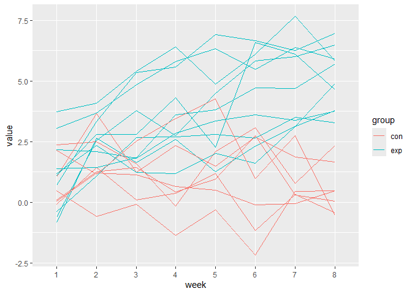

Homework 5 Kad2243
================
2026-11-18

### Problem 1 - Creating a function for shared birthday probability

library calls

``` r
library(tidyverse)
```

    ## ── Attaching core tidyverse packages ──────────────────────── tidyverse 2.0.0 ──
    ## ✔ dplyr     1.2.1     ✔ readr     2.2.0
    ## ✔ forcats   1.0.1     ✔ stringr   1.6.0
    ## ✔ ggplot2   4.0.3     ✔ tibble    3.3.1
    ## ✔ lubridate 1.9.5     ✔ tidyr     1.3.2
    ## ✔ purrr     1.2.2     
    ## ── Conflicts ────────────────────────────────────────── tidyverse_conflicts() ──
    ## ✖ dplyr::filter() masks stats::filter()
    ## ✖ dplyr::lag()    masks stats::lag()
    ## ℹ Use the conflicted package (<http://conflicted.r-lib.org/>) to force all conflicts to become errors

Creating function to check for duplicated birthdays in a group

``` r
#Creating random vector of values from 1 to 365 with duplicates of size n
#Checking if any duplicates are present, returning true

shared_bday = function(n) {
  bday = sample(1:365, n, replace = TRUE)
  duplicates = any(duplicated(bday))
  
  return(duplicates)
  
}

  #Testing
  shared_bday(200)
```

    ## [1] TRUE

``` r
  #1000 iterations averaged for groups of 2 to 50
  
  set.seed(123)
  
  #Creating vector for shared prob
  prob_shared <- c()
  
  for(i in 2:50) {
    shared_count <-0
    for ( j in 1:1000){
      if (shared_bday(i))shared_count <- shared_count +1
    }
    prob_shared[i] <- shared_count/1000
  }
  
  #Plot of simulated probabilities
  prob_shared <- data.frame( n = 2:50, prob = prob_shared[2:50])
  
  ggplot(data= prob_shared,aes(n, y = prob))+ geom_point()+ geom_line()
```

<!-- -->

As size of the group increased, as does probability of a shared
birthday, as expected. This increase appears almost linear.

### Problem 2 - iteration to import data

Creating a tidy data-frame with longitudinal data

Data import:

``` r
#import data using for loop

#creating list of the files
data <- tibble(file =list.files(
  path = "data", full.names = TRUE))
  
data <- data %>%
  mutate(data = purrr::map(file, read.csv))
```

Data Tidying:

``` r
long_data_tiddy <- data %>%
  mutate(file = str_remove (file, "data/"), file =str_remove(file, "\\.csv"))%>%
  separate(file, into = c("group", "id"), sep = "_")%>%
  unnest(data) %>%
  pivot_longer(
    cols = week_1:week_8,
    names_to =  "week",
    names_prefix = "week_",
    values_to =  "value"
  )
```

Longitudinal data plot:

``` r
#Spaghetti plot - used interaction for unique combos of id and treatmemt group
ggplot(long_data_tiddy, aes(x=week, y = value,
                            group = interaction(group, id),
                            color =group)) +
  geom_line()
```

<!-- -->

Control group members have lower obseved values than the experimental
group on average.

### Problem 3 - One sample t-test power

``` r
#Create function to return 5000 set's mean and p-val 
set.seed(123)

u<- c()
p<- c()
for (i in 1:5000){
  x <- rnorm(30, 0, 5)
  t_val <- t.test(x)
  u[i] <- mean(x)
  p[i] <- t_val$p.value
}

sim_pvals <- data.frame(sim = 1:5000, u, p)
```

``` r
#Repeating simulation for variable means
set.seed(123)

sim_pvals_means <- data.frame()

for (i in 1:6) {
u<- c()
p<- c()

for (j in 1:5000){
  x <- rnorm(30, i, 5)
  t_val <- t.test(x)
  u[j] <- mean(x)
  p[j] <- t_val$p.value
}

sim_pvals_means <- rbind(sim_pvals_means, data.frame(mean = i, sim = 1:5000, u, p))

}
```

Plotting simulated data

``` r
# Creating variable in data set for rejection of null

sim_pvals_means <- sim_pvals_means%>%
  mutate(
    reject = p < 0.005
  )

#Plot precentage rejected 
```
