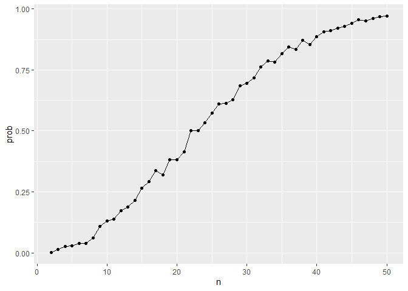

Homework 5 Kad2243
================
2026-11-18

### Creating a function for shared birthday probability

library calls

``` r
library(tidyverse)
```

    ## ── Attaching core tidyverse packages ──────────────────────── tidyverse 2.0.0 ──
    ## ✔ dplyr     1.2.1     ✔ readr     2.2.0
    ## ✔ forcats   1.0.1     ✔ stringr   1.6.0
    ## ✔ ggplot2   4.0.3     ✔ tibble    3.3.1
    ## ✔ lubridate 1.9.5     ✔ tidyr     1.3.2
    ## ✔ purrr     1.2.2     
    ## ── Conflicts ────────────────────────────────────────── tidyverse_conflicts() ──
    ## ✖ dplyr::filter() masks stats::filter()
    ## ✖ dplyr::lag()    masks stats::lag()
    ## ℹ Use the conflicted package (<http://conflicted.r-lib.org/>) to force all conflicts to become errors

Creating function to check for duplicated birthdays in a group

``` r
#Creating random vector of values from 1 to 365 with duplicates of size n
#Checking if any duplicates are present, returning true

shared_bday = function(n) {
  bday = sample(1:365, n, replace = TRUE)
  duplicates = any(duplicated(bday))
  
  return(duplicates)
  
}

  #Testing
  shared_bday(200)
```

    ## [1] TRUE

``` r
  #1000 iterations averaged for groups of 2 to 50
  
  set.seed(123)
  
  #Creating vector for shared prob
  prob_shared <- c()
  
  for(i in 2:50) {
    shared_count <-0
    for ( j in 1:1000){
      if (shared_bday(i))shared_count <- shared_count +1
    }
    prob_shared[i] <- shared_count/1000
  }
  
  #Plot of simulated probabilities
  prob_shared <- data.frame( n = 2:50, prob = prob_shared[2:50])
  
  ggplot(data= prob_shared,aes(n, y = prob))+ geom_point()+ geom_line()
```

<!-- -->

As size of the group increased, as does probability of a shared
birthday, as expected.
